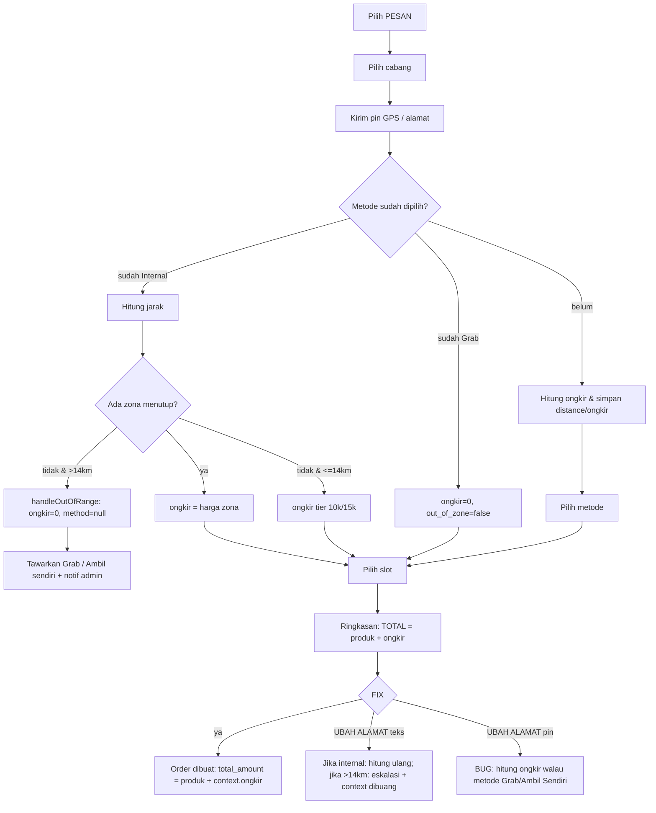

# Analisis: Kurir Eksternal, Radius, dan Biaya Pengiriman (Pemesanan + Chat Bot)

> **Metode**: cross-check kode (bukan asumsi), lalu dijalankan probe runtime sementara di database SQLite in-memory untuk membuktikan perilaku. Semua probe sudah dihapus setelah verifikasi.
> **Basis kode**: commit kerja saat ini, 20 Okt 2026. Stack Laravel 10 + Meta WhatsApp Cloud API.
> **Baseline test suite**: `215 passed, 7 skipped, 2 deprecated` (561 assertion) — tidak ada regresi yang tersisa dari probe.
> **Legenda bukti**: `[KODE]` dibaca langsung dari source · `[RUNTIME]` dibuktikan lewat eksekusi · `[INFERENSI]` simpulan turunan, bukan perilaku yang diuji langsung.

---

## 1. Jawaban Langsung (Ringkas)

| Pertanyaan | Jawaban | Bukti |
|---|---|---|
| Kalau pakai kurir **eksternal** (Grab/GoSend), apakah kena ongkir/tambahan biaya? | **Tidak.** `ongkir` dipaksa `0` dan tidak pernah dihitung dari jarak. Biaya driver dibayar langsung ke driver, **di luar sistem** (tidak dicatat, tidak masuk `total_amount`). | `[KODE]` `OrderBotService::processGrabGoSend()` 1823-1830, `finalizeCourierLocation()` 189-203, `handleLocationOrAddress()` 1918-1938 |
| Kalau keluar radius (mis. >14 km), apakah ada **tambahan biaya pengiriman**? | **Tidak ada surcharge.** Yang terjadi: kurir internal ditolak, ongkir direset `0`, pesanan dialihkan ke **Grab/GoSend** atau **ambil sendiri**. Tidak ada tarif progresif, tidak ada biaya luar-radius. | `[KODE]` `handleOutOfRange()` 2830-2867 · `[RUNTIME]` probe D, E |
| Apakah ongkir kurir internal benar-benar ditagihkan? | **Ya**, tapi **flat per zona** (Rp10.000 / Rp15.000) dan **berbasis perkiraan jarak**, bukan tarif per km. | `[KODE]` `DeliveryZoneService` 10-64 · `[RUNTIME]` probe L |
| Apakah nominal ongkir tersimpan sebagai data? | **Tidak.** Hanya `total_amount` gabungan + teks di kolom `note`. Tidak ada kolom `ongkir`, `delivery_method`, `distance_km` di `orders`. | `[KODE]` migrasi `2025_08_15_050259_create_orders_table.php` 13-25, `confirmOrder()` 3211-3226 |
| Apakah nominal ongkir bisa berubah setelah alamat dikoreksi? | **Ya, dan di sinilah bug paling mahal berada** (lihat §5). | `[RUNTIME]` probe A, B, F, G |

**Kesimpulan inti:** sistem saat ini **tidak memiliki konsep "biaya tambahan karena keluar radius"**. Di luar radius sistem justru **membebaskan** ongkir dari tagihan (0) dan menyerahkan biaya ke driver eksternal. Jika kebutuhan bisnis adalah menagih tambahan saat keluar radius, fitur itu **belum ada** — bukan sekadar tidak berfungsi.

---

## 2. Matriks Perilaku per Metode Pengiriman

| Metode | `delivery_method` | Ongkir ditagih | Perhitungan radius | Di luar radius | Muncul di `total_amount` |
|---|---|---|---|---|---|
| Ambil sendiri | `self_pickup` | Rp0 | Tidak dicek | Tetap boleh | Tidak |
| Grab/GoSend | `grab_gosend` | Rp0 (selalu) | **Tidak dicek** | Tetap boleh (memang untuk luar area) | Tidak |
| Kurir internal | `internal_courier` | Rp10.000 / Rp15.000 | Haversine GPS **atau** keyword alamat | Ditolak → dialihkan ke Grab/ambil sendiri | Ya |

Sumber: `processSelfPickup()` 1814-1821, `processGrabGoSend()` 1823-1854, `processInternalCourier()` 1855-1889, `askDeliveryMethod()` 2884-2907.

---

## 3. Rumus & Tabel Harga yang Benar-Benar Berlaku

`DeliveryZoneService::calculateOngkir()` 10-56, urutan prioritas:

1. **Zona eksplisit menang lebih dulu**: ambil zona aktif di region itu dengan `distance_km >= jarak`, urut jarak terkecil → `ongkir` zona tersebut. **Tidak ada cek radius** di langkah ini.
2. Jika tidak ada zona dan `jarak > 14` → `needs_escalation = true`, `ongkir = 0`.
3. Jika tidak ada zona dan `jarak <= 14` → tier: `< 10 km → 10.000`, `<= 14 km → 15.000`.
4. Hasil di-cache 24 jam dengan key `ongkir_{regionId}_{distanceKm}`.

Konsekuensi yang **terbukti** dari urutan ini:

```
[KODE] Zona 15 km (Ubud) membuat jarak 14.5–15.0 km tetap Rp15.000 (tidak eskalasi).
[KODE] Zona 10 km (Batu) membuat jarak 8.5 km ditagih Rp15.000 (lompat tier, bukan Rp10.000).
[KODE] Tier <10km/≤14km praktis mati jika setiap region punya zona lengkap.
[KODE] Tidak ada cache invalidation: Cache::forget tidak ada di seluruh app/.
```

Tabel hasil nyata untuk seed Denpasar (probe L):

| Jarak | Ongkir | Eskalasi | Zona terpilih |
|---|---|---|---|
| 1–2 km | 10.000 | tidak | Pusat Kota Denpasar (2 km) |
| 5 km | 10.000 | tidak | Denpasar Selatan (5 km) |
| 7.9–8 km | 10.000 | tidak | Kuta (8 km) |
| 8.5–12 km | 15.000 | tidak | Canggu (12 km) |
| 13.9–15 km | 15.000 | tidak | Ubud (15 km) |
| 15.1 km | 0 | **ya** | — |

> Artinya "radius 14 km" **bukan** batas keras: selama masih ada zona yang menutup, jarak 15 km tetap dilayani kurir internal dengan Rp15.000.

---

## 4. Alur Radius & Ongkir (Aktual)



---

## 5. Temuan Bug (Terurut Dampak Finansial)

### 🔴 B1 — `UBAH ALAMAT` via pin menagih ongkir ke pesanan **Grab/GoSend** dan **Ambil Sendiri**

- **Lokasi**: `OrderBotService::saveEditedPinAddress()` 2083-2113. Fungsi ini **tidak memeriksa `delivery_method`** dan selalu menulis `ongkir`, `distance_km`, lalu `sendOrderSummary()`.
- **Efek**: ringkasan tetap menulis `Ongkir (Grab/GoSend): dibayar langsung ke driver` (2086-2089), **tetapi** `TOTAL` sudah memasukkan `ongkir` karena `$totalAll = $totalProduct + $ongkir` (3070). Customer melihat "dibayar ke driver" namun tetap ditagih ongkir internal.
- **Bukti runtime (probe A)**:
  ```
  context ongkir = 10000
  Ringkasan: "Ongkir (Grab/GoSend): dibayar langsung ke driver"
             "TOTAL: Rp 19.000"        ← produk 9.000 + ongkir 10.000
  Order tersimpan: total_amount = 19000
  ```
- **Bukti runtime (probe B, self_pickup)**: order tersimpan `total_amount = 19000` padahal harusnya `9000`.
- **Dampak**: overcharge Rp10.000–15.000 per pesanan; potensi komplain/refund; laporan omzet tidak sesuai.
- **Catatan**: jalur teks (`saveEditedAddress()` 2142-2175) **benar** — hanya menghitung ulang untuk `internal_courier`.

### 🔴 B2 — Harga kurir internal tidak dihitung ulang dari alamat final (salah tagih dua arah)

- **Lokasi**: `processInternalCourier()` 1871-1881 berhenti lebih awal bila `location_done` + `distance_km` + `ongkir` sudah terisi; `refreshAddressAndOngkir()` hanya dipanggil saat `delivery_method` sudah ada (1385, 1450).
- **Efek**: bila customer mengirim **pin dekat** lebih dulu (wajib di alur "lokasi dulu"), lalu mengisi **alamat formulir yang lebih jauh**, harga tetap memakai pin lama. Dan sebaliknya.
- **Bukti runtime**:
  - **probe G**: pin pusat kota (0 km, zona 3 km → Rp10.000) + alamat formulir **Sidoarjo (12 km, zona Rp15.000)** → order tetap `ongkir 10000` → **undercharge Rp5.000**.
  - **probe F**: pin 0 km + alamat formulir **Ubud** → order `Jarak: 0km` di note, alamat order "Jl. Raya Ubud", ongkir 15000 (kebetulan tertutup zona 15 km) → **jarak yang tercatat salah**, dasar audit tidak valid.
- **Dampak**: undercharge/overcharge tidak terprediksi; `Jarak` di nota tidak bisa dipakai sebagai bukti.

### 🔴 B3 — `out_of_zone` bersifat *sticky*: pin koreksi tidak pernah membuka kembali kurir internal

- **Lokasi**: `routeLocationMessage()` 155-161 — saat state `AWAITING_DELIVERY_METHOD`, pin hanya disimpan ke `pending_location`, **tidak** menghitung ulang jarak/`out_of_zone`. `handleDeliveryMethod()` 1796 memblokir internal berdasarkan flag lama.
- **Bukti runtime (probe D)**:
  ```
  pin jauh  → out_of_zone=true, jarak 27.8 km
  pin dekat → out_of_zone TETAP true, jarak TETAP 27.8 km
  pilih "3" → ditolak, delivery_method tetap null
  ```
- **Tambahan `[KODE]`**: `processGrabGoSend()` mengosongkan `pending_location` tanpa memakai koordinatnya, dan `delivery_address` tidak diperbarui — jadi pin koreksi **hilang** dan order Grab memakai alamat jauh yang lama.
- **Dampak**: customer terkunci; satu-satunya jalan keluar adalah restart (`PESAN`/`reset`), yang tidak diberitahukan secara eksplisit.

### 🟠 B4 — `UBAH ALAMAT` (teks/pin) ke area jauh **menghapus seluruh konteks** pesanan, tidak menawarkan Grab

- **Lokasi**: `saveEditedAddress()` 2159-2171 dan `saveEditedPinAddress()` 2091-2102 → `clearContext()` + `ESCALATED_TO_HUMAN`.
- **Bukti runtime (probe K)**: `state = ESCALATED_TO_HUMAN`, `context = null` → keranjang, penerima, tanggal, slot **hilang**.
- **Kontradiksi**: di tahap lokasi, area jauh **tidak** dead-end — `handleOutOfRange()` menawarkan Grab/ambil sendiri (2830-2867). Dua jalur untuk kasus yang sama berperilaku berbeda.
- **Dampak**: pesanan batal diam-diam; customer harus mengulang dari nol; potensi kehilangan order.

### 🟠 B5 — Titik referensi toko hanya dikenal untuk 3 slug; region lain memakai koordinat Denpasar

- **Lokasi**: `DeliveryZoneService::getReferencePoint()` 135-157 — hardcode `surabaya`, `malang`, `denpasar`; fallback `denpasar` + `Log::warning`.
- **Bukti runtime (probe H)**: region `bandung`, koordinat tengah Bandung → jarak **858.87 km** → `needs_escalation = true` → kurir internal mustahil dipakai.
- **Akar masalah**: tabel `regions` **tidak punya kolom `lat`/`lng`** (migrasi `2025_08_01_082606_create_regions_table.php` 13-19), sehingga lokasi toko tidak bisa dikonfigurasi tanpa deploy kode.
- **Dampak**: setiap cabang baru otomatis "rusak" untuk kurir internal.

### 🟠 B6 — Zona ongkir tidak bisa dikelola admin (klaim dokumentasi salah)

- **Lokasi**: `routes/web.php` 93-175 hanya memuat `regions` (owner phone + test). **Tidak ada** route/controller CRUD `delivery_zones`.
- `PROJECT_SUMMARY.md` 489 & 548 mengklaim "dikelola admin via CRUD" → **tidak benar**.
- **Dampak**: perubahan tarif/zona harus lewat DB/seed + deploy; tidak ada audit trail; risiko salah tarif produksi.
- **Tambahan**: `Cache::put(... addHours(24))` tanpa `Cache::forget` di mana pun → perubahan zona bisa telat berlaku hingga 24 jam.

### 🟠 B7 — Region nonaktif masih bisa dijadikan cabang pengiriman lewat atribusi alamat

- **Lokasi**: `ConversationRegionResolver::regionIdForAddress()` 164-180 mengambil `DeliveryZone` tanpa filter `regions.is_active`.
- **Bukti runtime (probe I)**: alamat "Jl. Legian, Kuta" → `region_id = 2` (Denpasar, `is_active = false`).
- **Dampak**: katalog/ongkir/notifikasi owner mengarah ke cabang mati; customer bisa menyelesaikan order ke cabang yang seharusnya tidak melayani.

### 🟡 B8 — Tanggal kirim hilang dari `note` (variabel `$customer` tertimpa model)

- **Lokasi**: `confirmOrder()` 3190 `$customer = $this->findOrCreateCustomer(...)` (mengembalikan model `Customer`), lalu 3218-3219 memakai `$customer['date']` → tidak ada → `'-'`.
- **Bukti runtime (probe J)**: context berisi `date = 25 Oct 2026`, order tersimpan `note: "Tanggal kirim: -"`.
- **Dampak**: tanggal pengiriman tidak tercatat di order manapun; operasi & pengiriman berisiko salah jadwal. `Tanggal` tidak punya kolom sendiri.

### 🟡 B9 — Ongkir tidak terlihat di UI admin & invoice

- **Lokasi**: `Admin/OrderController::details()` 146-155 hanya mengirim `total_amount` + `note`; invoice (`historys/invoice.blade.php` 269, 349) hanya menampilkan Total. `note` hanya bisa dibuka lewat modal catatan di daftar order.
- **Dampak**: admin tidak bisa memverifikasi ongkir tanpa membaca teks; tidak ada dasar untuk sengketa biaya kirim; retur menghitung ulang dari harga item saja (`ReturnController` 132-160) sehingga ongkir tidak pernah dikembalikan `[INFERENSI]`.

### 🟡 B10 — Checkout manual kurir tidak punya ongkir/metode pengiriman sama sekali

- **Lokasi**: `Kurir/PesananController::checkout()` 223-233 tidak memvalidasi `ongkir`/metode; 292-302 membuat order dengan `total_amount = 0`; 375-377 total = jumlah item saja; `channel` tidak diisi (default migrasi `'web'`).
- **Dampak**: order yang dibuat kurir internal tidak pernah memuat biaya kirim; jika toko menagih ongkir, harus ditulis manual di catatan → tidak terhitung di omzet/laporan.

### 🟡 B11 — Notifikasi admin dalam aplikasi tidak memuat metode & ongkir

- **Lokasi**: `AdminNotificationRouterService::notifyNewOrder()` 50-60 — hanya invoice, nama, total, item.
- **Kontras**: format WA ke owner (`buildOwnerOrderFormat()` 328-352) menyertakan `note` (yang berisi Metode/Jarak/Slot).
- **Dampak**: admin tidak tahu order mana yang butuh booking Grab, mana yang kurir internal — kecuali membuka catatan satu per satu.

### 🟢 B12 — Sisa `distance_km` pada pesanan Ambil Sendiri

- **Lokasi**: `processSelfPickup()` 1814-1821 tidak menghapus `distance_km`/`ongkir` lama (ongkir di-set 0, jarak tidak).
- **Dampak**: note menampilkan `Jarak: 2.34km` untuk pesanan ambil sendiri — kosmetik, tapi menyesatkan audit.

### 🟢 B13 — Zona 15 km mematikan eskalasi >14 km secara desain

- **Lokasi**: 20-35 (zona diperiksa sebelum cek `> 14`).
- **Dampak**: "batas 14 km" yang tertulis di dokumen **tidak konsisten** dengan perilaku; keputusan bisnis harus eksplisit (zona boleh melebihi batas radius atau tidak).

### 🟢 B14 — Tidak ada tarif per item/berat/volume

- Hanya satu ongkir per order, tidak ada perkalian qty. `[KODE]` 3067-3070.

---

## 6. Cakupan Test (yang ada vs yang bolong)

| Perilaku | Test ada? | Catatan |
|---|---|---|
| Tier & eskalasi dasar | ✅ `tests/Unit/Services/DeliveryZoneServiceTest.php` | 10 test, semua lulus |
| Zona >14 km menang atas eskalasi | ✅ idem (`test_explicit_zone_wins_over_escalation`) | |
| Grab tidak menghitung ongkir (pin) | ✅ `OrderBotExternalCourierTest` | Hanya jalur pin saat `AWAITING_LOCATION_OR_ADDRESS` |
| Luar jangkauan → tawarkan Grab, admin dinotifikasi | ✅ idem | |
| Internal ditolak saat `out_of_zone` | ✅ idem | Tidak menguji pemulihan flag |
| **Grab/Ambil Sendiri + UBAH ALAMAT pin (B1)** | ❌ | Bug lolos karena tidak diuji |
| **Alamat formulir ≠ pin (B2)** | ❌ | Undercharge lolos |
| **Pin koreksi setelah out_of_zone (B3)** | ❌ | Sticky flag lolos |
| **Ubah alamat jauh saat ringkasan (B4)** | ❌ | Context hilang lolos |
| **Region slug baru / titik referensi (B5)** | ❌ | |
| **Tanggal kirim tersimpan (B8)** | ❌ | `note` tidak pernah di-assert isinya |
| **Ongkir muncul di data/UI admin (B9)** | ❌ | Tidak ada kolom → tidak bisa di-assert |

> Tidak ada satu pun test yang meng-assert isi `orders.note` atau memisahkan komponen ongkir di `total_amount`. Itulah sebabnya B1/B2/B8 tidak terdeteksi.

---

## 7. Selisih Dokumentasi vs Kode

| Klaim dokumen | Realita kode |
|---|---|
| `docs/ALUR_BOT_PESANAN.md:257` — 4 slot (`slot_1..slot_4`, 15:00–17:00) | **3 slot** (`slot_1..slot_3`, 13:00–17:00) — 2922-2940 |
| `docs/ALUR_BOT_PESANAN.md:247` — alamat tak dikenal default 5.0 km | **`null`** — pemanggil wajib minta pin (84-114) |
| `docs/ALUR_BOT_PESANAN.md:250` — >14 km → `ESCALATED_TO_HUMAN` (dead-end) | Sekarang **menawarkan Grab/ambil sendiri** — 2830-2867 |
| `PROJECT_SUMMARY.md:489,548` — zona "dikelola admin via CRUD" | **Tidak ada CRUD**; hanya seeder/DB |
| `docs/ALUR_BOT_PESANAN.md:294` — `total_amount` = harga × qty + ongkir | Benar, tapi **tidak ada pemisahan komponen** dan bisa tercemar B1 |
| `docs/ALUR_BOT_PESANAN.md:236` — estimasi Grab Rp100.000–150.000 | Tidak ada implementasi; hanya teks dokumen |

---

## 8. Dampak Bisnis yang Terukur

1. **Kebocoran/kelebihan tagih ongkir**: B1 (overcharge 10–15 rb), B2 (under/overcharge 5 rb+) — keduanya terjadi **setelah** customer melihat ringkasan, dan tidak ada rekonsiliasi karena ongkir bukan kolom.
2. **Order hilang**: B4 membuang konteks → customer harus mengulang; tidak ada notifikasi ke customer bahwa pesanan batal (hanya "hubungi admin").
3. **Cabang baru tidak bisa jalan**: B5 membuat semua jarak dihitung dari Denpasar.
4. **Tidak ada kontrol operasional tarif**: B6 + cache 24 jam → perubahan harga tidak bisa langsung berlaku & tidak ada jejak audit.
5. **Data pengiriman tidak auditable**: B8/B9/B10 → tidak bisa menjawab "berapa ongkir yang kita tagih bulan ini", "order mana yang pakai Grab", "biaya driver aktual vs estimasi".

---

## 9. Rekomendasi Perbaikan (berurutan, tanpa mengubah arsitektur)

### Fase 1 — Hentikan kerugian (kecil, berisiko rendah)
1. **B1**: di `saveEditedPinAddress()`, hitung ongkir **hanya** bila `delivery_method === 'internal_courier'`. Untuk Grab/self-pickup: update alamat + `distance_km = null`, `ongkir = 0`, tanpa eskalasi.
2. **B2**: panggil `refreshAddressAndOngkir()` **selalu** saat `delivery_method === 'internal_courier'`, termasuk di `processInternalCourier()` sebelum short-circuit.
3. **B8**: simpan `$orderCustomer = $context['order_customer']` sebelum `findOrCreateCustomer()`, pakai variabel itu untuk `note`; pertimbangkan kolom `delivery_date`.
4. **B3**: saat `AWAITING_DELIVERY_METHOD`, pin baru harus **menghitung ulang** jarak, memperbarui `delivery_address`, dan mereset `out_of_zone` jika masuk radius.

### Fase 2 — Data yang benar (perlu migrasi)
5. Tambah kolom `orders`: `delivery_method`, `distance_km`, `shipping_fee`, `shipping_zone_id`, `external_courier_fee` (nullable, terisi manual oleh admin setelah driver dipesan).
   - `total_amount` tetap = item + `shipping_fee`, sehingga `shipping_fee` bisa diaudit tanpa parsing teks.
6. Tampilkan `shipping_fee` di ringkasan, invoice, modal verifikasi admin, dan export.
7. Notifikasi admin (`notifyNewOrder`) menyertakan metode + ongkir + jarak.

### Fase 3 — Konfigurasi & radius
8. Tambah `regions.latitude`/`regions.longitude` + form admin; hapus hardcode `getReferencePoint()`.
9. Buat CRUD `delivery_zones` di admin + `Cache::forget` per region/zona setiap perubahan.
10. Filter `regions.is_active` di `ConversationRegionResolver::regionIdForAddress()`.
11. Putuskan eksplisit: apakah zona boleh melewati 14 km (B13). Jika tidak, tambahkan guard `distance_km <= max_radius` saat memilih zona.

### Fase 4 — Biaya eksternal (jika memang ingin ditagih)
12. Jika bisnis ingin **menagih** biaya driver (bukan "dibayar langsung"), tambahkan `external_courier_fee` + konfirmasi nominal oleh admin sebelum FIX/setelah driver dipesan, dan masukkan ke `total_amount` **hanya** untuk metode itu.

### Fase 5 — Test penjaga regresi
13. Test baru (prioritas): `grab + UBAH ALAMAT pin → ongkir tetap 0`; `self_pickup + UBAH ALAMAT pin → ongkir 0`; `pin dekat + alamat jauh → ongkir ikut alamat`; `out_of_zone lalu pin dekat → internal bisa dipilih`; `note memuat tanggal kirim`; `region slug baru tidak memakai Denpasar`.

---

## 10. Lampiran — Bukti Runtime (probe sementara, sudah dihapus)

Semua probe dijalankan dengan `php artisan test` pada SQLite `:memory:` + `Http::fake()` untuk Graph API. Ringkasan keluaran:

| Probe | Skenario | Hasil |
|---|---|---|
| A | Grab + UBAH ALAMAT pin | `ongkir=10000`, summary menulis "dibayar langsung ke driver", `TOTAL=19000`, order `total_amount=19000` |
| B | Self-pickup + UBAH ALAMAT pin | order `total_amount=19000` (produk 9.000) |
| C | Internal + pin dekat | `distance=2.34`, `ongkir=10000` |
| D | Pin jauh → pin dekat → pilih "3" | `out_of_zone` tetap `true`, `distance_km` tetap `27.8`, state tetap `AWAITING_DELIVERY_METHOD`, method `null` |
| E | Internal + alamat "Jl. Raya Ubud" (zona 15 km) | `ongkir=15000`, `needs_escalation=false` |
| F | Pin 0 km + alamat formulir Ubud | `distance=0`, `ongkir=15000`, order alamat Ubud, note `Jarak: 0km` |
| G | Pin 0 km (zona 3 km/10rb) + alamat Sidoarjo (zona 12 km/15rb) | `ongkir` tetap `10000` → kurang tagih Rp5.000 |
| H | Region `bandung` + koordinat Bandung | `distance=858.87` → eskalasi |
| I | Alamat Kuta, region Denpasar nonaktif | atribusi ke region nonaktif |
| J | Customer lama + FIX | note `Tanggal kirim: -` |
| K | Grab + UBAH ALAMAT pin di luar radius | `ESCALATED_TO_HUMAN`, `context=null` |
| L | Tabel harga seed Denpasar | 8.5 km → 15.000; 15.0 km → 15.000; 15.1 km → eskalasi |

Baseline akhir setelah probe dihapus: **215 passed, 7 skipped, 2 deprecated**.

---

## 11. Kesimpulan Satu Paragraf

Untuk **kurir eksternal**, sistem memang tidak menagih ongkir (0) dan biaya driver berada di luar sistem — tetapi ada bug yang bisa **menagihkan ongkir internal ke pesanan Grab/Ambil Sendiri** ketika customer memakai `UBAH ALAMAT` lewat pin. Untuk **keluar radius**, tidak ada biaya tambahan sama sekali: sistem menolak kurir internal, mengosongkan ongkir, lalu menawarkan Grab atau ambil sendiri. Masalah yang lebih mendasar adalah **harga kurir internal dapat dihitung dari pin lama, bukan alamat final**, dan **tidak ada kolom/data ongkir** sehingga seluruh transaksi biaya kirim tidak dapat diaudit. Urutan perbaikan paling tepat: hentikan overcharge B1/B2, simpan komponen biaya kirim sebagai data, baru bangun konfigurasi radius/zona yang bisa dikelola admin.
