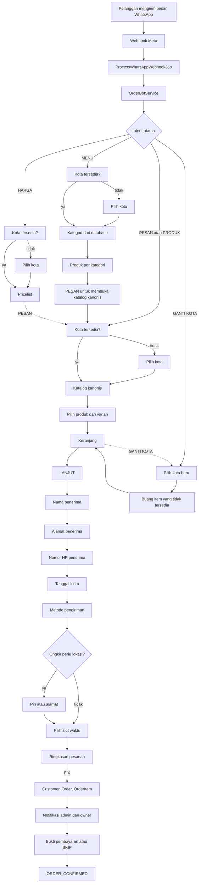

# Alur Bot Pesanan WhatsApp — Kue Pandan Asli

> Dokumen ini mencerminkan implementasi aktual setelah **Fase 9 (14 November 2026)**.
> Sumber utama: `app/Services/WhatsApp/OrderBotService.php`, `app/Enums/OrderBotConversationState.php`,
> `app/Services/WhatsApp/ConversationRegionResolver.php`, `app/Services/WhatsApp/ProductListRenderer.php`,
> dan `app/Services/Pricing/PriceResolver.php`.

## 1. Ringkasan

Bot WhatsApp adalah state machine 13 state yang memandu pelanggan dari pemilihan kota sampai pembayaran.
Alur utama yang berlaku sekarang:

```text
Sambutan
→ kota otomatis atau ditanya sekali
→ satu katalog produk
→ pilih produk/varian
→ keranjang
→ LANJUT
→ nama penerima
→ alamat penerima
→ nomor HP penerima
→ tanggal kirim
→ metode pengiriman dan ongkir
→ slot waktu
→ ringkasan
→ FIX
→ bukti pembayaran atau SKIP
→ selesai
```

Invariant penting:

- `PESAN` dan `PRODUK` membuka **katalog kanonis** yang sama.
- `HARGA` membuka pricelist; `MENU` membuka kategori dari database.
- `ConversationRegionResolver` menentukan kota; `PriceResolver` menentukan harga.
- Nomor penerima tetap memakai `form_step = 6`, tetapi pertanyaan linear adalah **nama → alamat → nomor → tanggal**.
- `footerFor(OrderBotConversationState)` adalah sumber tunggal footer per state.
- Sesi idle memakai `resetConversationIfStale()`; tidak ada timeout baru.
- Teks pelanggan WhatsApp maksimal 4096 karakter.
- R-07 tetap **OPEN** dan belum diimplementasikan.

## 2. Komponen Utama

| Peran | File |
|---|---|
| Entry point webhook | `app/Http/Controllers/Chatbot/WhatsAppWebhookController.php` |
| Pemrosesan antrean | `app/Jobs/ProcessWhatsAppWebhookJob.php` |
| Mesin state dan copy pelanggan | `app/Services/WhatsApp/OrderBotService.php` |
| Daftar state | `app/Enums/OrderBotConversationState.php` |
| Penentu kota percakapan | `app/Services/WhatsApp/ConversationRegionResolver.php` |
| Renderer katalog/pricelist | `app/Services/WhatsApp/ProductListRenderer.php` |
| Sumber harga per kota | `app/Services/Pricing/PriceResolver.php` |
| Hitung ongkir dan zona | `app/Services/WhatsApp/DeliveryZoneService.php` |
| Quote ongkir dan konflik lokasi | `app/Services/WhatsApp/DeliveryQuoteService.php` |
| Pengiriman ke Meta Graph API | `app/Services/WhatsApp/WhatsappMetaService.php` |
| Notifikasi admin/pemilik | `app/Services/WhatsApp/AdminNotificationRouterService.php` |
| Model order | `app/Models/Order.php` |

## 3. Entry Point dan Pemrosesan

Webhook menerima GET untuk verifikasi dan POST untuk event di tiga alias:

| Method | URL |
|---|---|
| GET/POST | `/api/webhook/meta` |
| GET/POST | `/api/webhook/whatsapp/meta` |
| GET/POST | `/api/v1/webhook/whatsapp` |

`WhatsAppWebhookController` memvalidasi payload/signature, lalu dispatch `ProcessWhatsAppWebhookJob`.
Job melakukan normalisasi nomor, dedup pesan, mencari/membuat percakapan, menyimpan pesan, lalu memanggil:

- `OrderBotService::handleMessage()` untuk teks, tombol, dan media;
- `OrderBotService::handleLocationMessage()` untuk pin GPS.

## 4. Perintah Utama dan Routing

| Perintah | Perilaku |
|---|---|
| `PESAN`, `ORDER`, `PRODUK` | Membuka katalog kanonis. Jika kota belum diketahui, kota ditanya lebih dulu. |
| `HARGA`, `PRICELIST`, `DAFTAR HARGA` | Membuka pricelist. Saat sedang mengisi field bebas, perintah tidak menelan jawaban pelanggan. |
| `MENU` | Membuka daftar kategori dari tabel `categories`. |
| `GANTI KOTA`, `UBAH KOTA`, `PINDAH KOTA` | Membuka pilihan kota baru dan mengunci pilihan sebagai override manual. |
| `LANJUT` | Mengakhiri’ajout produk lalu memulai form linear. |
| `FIX` | Mengonfirmasi ringkasan dan membuat order. |
| `UBAH ALAMAT` | Mengubah alamat dari ringkasan dan menghitung ulang ongkir bila perlu. |
| `BATAL` | Membatalkan alur/order baru yang belum dibayar dan mengosongkan context. |
| `SKIP` | Melewati bukti pembayaran; order tetap tersimpan. |
| `MULAI ULANG` | Mengembalikan percakapan ke sambutan. |

Pencocokan perintah utama menggunakan kata utuh/case-insensitive. Karena itu, teks seperti
`Jl. Batalyon`, `Warung Menu`, atau `Halo, saya Budi` tidak salah diperlakukan sebagai perintah.

## 5. State Machine

| State | Fungsi |
|---|---|
| `INIT` | Percakapan baru; mengirim sambutan. |
| `WELCOME_SENT` | Sambutan sudah dikirim; menerima intent utama. |
| `MENU_SELECTION` | Pelanggan memilih kategori atau nama produk. |
| `PRODUCT_BROWSING` | Melihat detail/daftar produk kategori. |
| `AWAITING_ORDER_FORM` | Memilih produk dan mengisi data penerima secara linear. |
| `AWAITING_DELIVERY_METHOD` | Memilih ambil sendiri, Grab/GoSend, atau kurir internal. |
| `AWAITING_LOCATION_OR_ADDRESS` | Meminta pin/alamat untuk ongkir atau titik jemput. |
| `AWAITING_DELIVERY_SLOT` | Memilih slot waktu pengiriman. |
| `ORDER_SUMMARY` | Menampilkan rincian produk, ongkir, penerima, dan total. |
| `AWAITING_PAYMENT_PROOF` | Menunggu bukti pembayaran atau `SKIP`. |
| `ORDER_CONFIRMED` | Order sudah dibuat; bukti diterima atau dilewati. |
| `ESCALATED_TO_HUMAN` | Percakapan diteruskan ke admin. |
| `CLOSED` | Percakapan ditutup. |

## 6. Alur Pemesanan End-to-End

### 6.1 Sambutan dan Penentuan Kota

Sambutan ringkas memuat nama toko dan kota pengiriman bila kota sudah diketahui.
Nomor admin diambil dari `AdminContactResolver`: `BOT_ADMIN_PHONE` diutamakan, lalu
`regions.owner_phone` sebagai fallback. Nomor hanya ditampilkan jika salah satunya terisi:

```dotenv
BOT_ADMIN_PHONE=
```

Penentuan kota memakai `ConversationRegionResolver` dengan prioritas:

1. customer terdaftar;
2. alamat/keyword zona;
3. kota default.

Sumber `manual` dan `customer` tidak ditimpa otomatis. `GANTI KOTA` memilih override `manual`.
Jika percakapan belum memiliki kota aktif, perintah katalog/pricelist/kategori menanyakan kota terlebih dahulu.

### 6.2 Katalog, Kategori, dan Pricelist

`ProductListRenderer` menjadi sumber tunggal daftar produk:

- mode `catalog` untuk `PESAN` dan `PRODUK`;
- mode `by_category` setelah memilih `MENU`;
- mode `pricelist` untuk `HARGA`.

Katalog hanya memuat produk aktif yang terlihat di kota pelanggan: produk khusus kota tersebut dan
produk lintas kota (`products.is_global = true`). Nomor katalog disimpan di `context.catalog_ids`,
sehingga angka yang diketik selalu referensikan daftar yang sedang ditampilkan.

### 6.3 Pilih Produk dan Keranjang

- Produk dapat dipilih dengan nomor katalog atau nama produk.
- Jumlah dapat ditulis sebagai `2x Kue Ijo`, `2 Kue Ijo`, atau `Kue Ijo isi 3, 2 pcs`.
- Produk multivarian meminta nomor varian.
- Produk single-variant langsung masuk ke keranjang.
- Setelah masuk keranjang, bot meminta “Mau pesan apa?” agar pelanggan dapat menambah produk atau mengetik `LANJUT`.

### 6.4 Form Linear

Progress disimpan di `context.form_step`:

| `form_step` | Isi | Perilaku |
|---|---|---|
| `0` | Pilih produk | Memproses nomor/nama produk dari katalog. |
| `4` | Tambah produk / `LANJUT` | `LANJUT` memulai data penerima. |
| `1` | Nama penerima | Minimal 2 karakter; angka/perintah eksak ditolak. |
| `2` | Alamat penerima | Minimal 10 karakter; alamat wajib selalu diminta. |
| `6` | Nomor HP penerima | Dinormalisasi ke format `62...` dan minimal 10 digit. |
| `3` | Tanggal kirim | Mendukung bahasa Indonesia dan tanggal numerik. |
| `5` | Setelah data lengkap | Lanjut ke metode pengiriman atau ringkasan bila metode/slot sudah tersedia. |

Urutan pertanyaan yang dijamin adalah:

```text
LANJUT → nama → alamat → nomor penerima → tanggal
```

`missingOrderFormStep()` mencari field pertama yang belum lengkap. `promptMissingOrderField()`
mengembalikan pelanggan tepat ke pertanyaan yang belum dijawab. Karena itu, ringkasan atau `FIX`
tidak dapat melewati nama, alamat, nomor penerima, atau tanggal yang belum ada.

Format lama `Nama | Alamat | Tanggal` masih dapat dibaca di langkah nama. Data yang valid langsung
diambil, lalu field yang belum lengkap tetap ditanyakan satu per satu.

### 6.5 Metode Pengiriman, Ongkir, dan Slot

| Pilihan | `delivery_method` | Ongkir bot | Lanjut |
|---|---|---:|---|
| `1` Ambil sendiri | `self_pickup` | Rp0 | Pilih slot. |
| `2` Grab/GoSend | `grab_gosend` | Rp0; dibayar ke driver | Alamat harus ada, lalu pilih slot. |
| `3` Kurir internal | `internal_courier` | Dihitung dari zona/jarak | Minta pin bila jarak belum diketahui, lalu pilih slot. |

Tersedia tiga slot:

| Pilihan | Slot |
|---|---|
| `1` | 09:00–11:00 |
| `2` | 11:00–13:00 |
| `3` | 13:00–15:00 |

Untuk kurir internal, alamat terakhir atau pin GPS menjadi sumber ongkir. Jika pin dan alamat
berbeda jauh, bot menginformasikan konflik dan meminta konfirmasi ulang. Jarak di luar jangkauan
tidak menghasilkan order gratis; pelanggan diberi pilihan Grab/GoSend atau ambil sendiri.

### 6.6 Ringkasan dan `FIX`

`sendOrderSummary()` memvalidasi ulang:

- produk/varian masih aktif dan tersedia di kota pelanggan;
- keranjang tidak kosong;
- nama, alamat, nomor penerima, dan tanggal lengkap;
- metode serta slot pengiriman tersedia.

Ringkasan berisi produk, varian, jumlah, harga kota, subtotal, ongkir, total, nama, alamat,
nomor penerima, tanggal, metode, dan slot.

`FIX` membuat order dalam transaksi database:

1. mengunci baris percakapan untuk mencegah order ganda;
2. mencari atau membuat customer;
3. memeriksa kuota order aktif;
4. resolve harga live melalui `PriceResolver`;
5. membuat `orders` dan `order_items`;
6. menyimpan `orders.recipient_phone`;
7. membuat notifikasi admin dan meneruskan ringkasan ke pemilik bila dikonfigurasi;
8. berpindah ke `AWAITING_PAYMENT_PROOF`.

`FIX` kedua pada order yang sama memakai order yang sudah dibuat; tidak membuat order ganda.

### 6.7 Bukti Pembayaran

- Gambar bukti → disimpan pada `orders.payment_proof`, diteruskan ke owner/admin, lalu state menjadi `ORDER_CONFIRMED`.
- `SKIP` → order tetap tersimpan tanpa bukti dan state menjadi `ORDER_CONFIRMED`.
- Bukti tanpa order yang jelas ditolak; bot tidak memberi sukses palsu.

### 6.8 Ganti Kota Saat Keranjang Ada

`GANTI KOTA` tetap tersedia dari setiap state aktif:

1. bot meminta kota baru;
2. item khusus kota lama yang tidak tersedia di kota baru dibuang;
3. produk lintas kota tetap dipertahankan;
4. pelanggan dikembalikan ke keranjang/`LANJUT`;
5. checkout dapat dilanjutkan dengan kota baru.

### 6.9 Sesi Idle

`resetConversationIfStale()` tetap menggunakan ambang konfigurasi
`services.whatsapp.session_expire_minutes` (default 60 menit). Keranjang dan data penerima
dipertahankan, tetapi order `baru` yang belum dibayar dari sesi lama dibatalkan agar tidak
menggantung sebagai ghost order.

## 7. Resolver Kota, Harga, dan Produk

### 7.1 `ConversationRegionResolver`

Resolver adalah satu-satunya penentu kota percakapan. Override manual hanya terjadi melalui
`GANTI KOTA`; customer terdaftar tetap menjadi sumber kota yang dikunci. Region memengaruhi
katalog, harga, ongkir, produk, dan notifikasi admin.

### 7.2 `PriceResolver`

`PriceResolver::priceFor()` mencari override pada `product_variant_prices` untuk kota tersebut.
Bila override tidak ada, harga dasar `product_variants.price` digunakan. Tidak ada duplikasi
produk untuk workaround harga per kota.

### 7.3 Visibilitas Produk

Produk aktif terlihat bila:

- `products.region_id` sama dengan kota percakapan; atau
- `products.is_global = true`.

Produk nonaktif tidak pernah masuk katalog, pricelist, atau order.

## 8. Footer per State

`OrderBotService::footerFor()` menjadi sumber tunggal footer:

| State | Footer |
|---|---|
| `INIT`, `WELCOME_SENT`, `MENU_SELECTION`, `PRODUCT_BROWSING` | `Perintah: *PESAN* · *MENU* · *HARGA* · *GANTI KOTA*` |
| `AWAITING_ORDER_FORM`, `AWAITING_DELIVERY_METHOD`, `AWAITING_LOCATION_OR_ADDRESS`, `AWAITING_DELIVERY_SLOT` | `Perintah: *BATAL* · *GANTI KOTA*` |
| `ORDER_SUMMARY` | `Perintah: *FIX* · *UBAH ALAMAT* · *BATAL*` |
| `AWAITING_PAYMENT_PROOF` | `Perintah: *SKIP* · *BATAL*` |
| `ORDER_CONFIRMED` | `Perintah: *PESAN* · *MENU*` |
| `CLOSED`, `ESCALATED_TO_HUMAN` | `Perintah: *PESAN*` |

State nonaktif hanya menawarkan perintah yang benar-benar dirutekan. `PESAN` dari
`CLOSED`/`ESCALATED_TO_HUMAN` membuka katalog kanonis; teks bebas di `ORDER_CONFIRMED`
tidak menurunkan state agar bukti susulan tetap tertangkap.

## 9. Diagram Mermaid



## 10. Contoh Percakapan

```text
👤 Pelanggan:  Halo
🤖 Bot:        Selamat pagi dari *Kue Pandan Asli* 🍃
               Kota pengiriman: *Surabaya*
               Perintah: *PESAN* · *MENU* · *HARGA* · *GANTI KOTA*

👤 Pelanggan:  PESAN
🤖 Bot:        ⭐ *List Produk — Kue Pandan Asli Surabaya*
               1. Kue Ijo — Isi 3, Isi 5, Isi 12
               ...

👤 Pelanggan:  1
🤖 Bot:        Pilih ukuran/varian:
               1. Isi 3
               2. Isi 5
               3. Isi 12

👤 Pelanggan:  2
🤖 Bot:        ✅ Kue Ijo — Isi 5 masuk keranjang.
               Mau pesan apa?

👤 Pelanggan:  LANJUT
🤖 Bot:        *Siapa nama penerimanya?*
               (bisa nama sendiri)

👤 Pelanggan:  Budi Santoso
🤖 Bot:        *Apa alamat lengkapnya?*
               Tulis jalan + nomor + patokan.

👤 Pelanggan:  Jl. Pahlawan No 10 Surabaya
🤖 Bot:        *Nomor HP penerima?*
               (contoh: 081234567890)

👤 Pelanggan:  081234567890
🤖 Bot:        *Mau dikirim tanggal berapa?*
               Contoh: 17 Nov 2026

👤 Pelanggan:  17 Nov 2026
🤖 Bot:        🚚 Pilih Metode Pengiriman
               1. Diambil Sendiri
               2. Grab/GoSend
               3. Kurir Internal

👤 Pelanggan:  1
🤖 Bot:        Pilih slot waktu pengiriman:
               1. 09:00–11:00
               2. 11:00–13:00
               3. 13:00–15:00

👤 Pelanggan:  1
🤖 Bot:        📋 *RINGKASAN PESANAN*
               Kue Ijo — Isi 5 | 1 | Rp...
               Ongkir: Rp0
               TOTAL: Rp...
               Penerima: Budi Santoso
               Alamat: Jl. Pahlawan No 10 Surabaya
               Nomor: 6281234567890
               Tanggal: 17 Nov 2026
               Perintah: *FIX* · *UBAH ALAMAT* · *BATAL*

👤 Pelanggan:  FIX
🤖 Bot:        ✅ *Pesanan Berhasil Dibuat!*
               Nomor Invoice: *INV/...*
               Total: *Rp...*
               Silakan kirim bukti pembayaran atau ketik *SKIP*.
```

## 11. Batas Operasional Saat Ini

- **R-07 OPEN:** catatan klien “Pada saat memilih ‘pesan’…” masih terpotong; tidak ada interpretasi baru yang diterapkan.
- **R-15:** infrastruktur harga per kota tersedia, tetapi data harga Surabaya/Malang per varian belum lengkap.
- `BOT_ADMIN_PHONE` dan `regions.owner_phone` sama-sama kosong membuat notifikasi admin/owner dilewati; isi salah satunya di environment tujuan.
- Dokumentasi ini tidak menyatakan deployment atau migrasi produksi telah dijalankan.
- Sumber kebenaran status fase ada di `docs/IMPLEMENTATION_PROGRESS.md`.

## 12. Verifikasi Fase 9

- `php artisan test --compact tests/Feature/WhatsApp` → **209 passed, 749 assertions**.
- `php artisan test --compact` → **318 passed, 7 skipped, 995 assertions**.
- Dua deprecation PHP 8.5 yang muncul (`PDO::MYSQL_ATTR_SSL_CA` dan `ReflectionMethod::setAccessible()`) bersifat pre-existing.
- Pint file PHP yang disentuh (termasuk command import) → **PASS**.
- Review whole-branch: 6 temuan Important (I-1…I-6) dan 5 Minor (M-1…M-5) sudah diperbaiki;
  regression test ada di `tests/Feature/WhatsApp/OrderBotReviewRegressionTest.php`.

---

*Dokumen wajib diperbarui bila ada perubahan pada `OrderBotService`, `OrderBotConversationState`, `ConversationRegionResolver`, `ProductListRenderer`, atau `PriceResolver`.*
