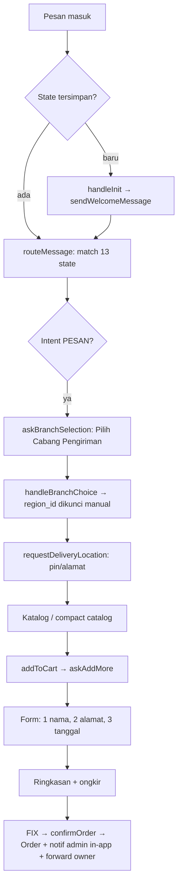

# Audit Revisi Chatbot — Kue Pandan Asli (Surabaya & Malang)

Dokumen audit READ-ONLY. Tidak ada perubahan kode pada tahap ini.
Sumber revisi: `docs/REVISI_KLIEN.md` (R-01 … R-18).
Semua klaim kode memakai format `path:function:line`. Klaim yang tidak ditemukan ditulis **TIDAK DITEMUKAN** beserta area pencarian.

---

## 1. Ringkasan Eksekutif

| Revisi | Ringkas | Status |
|---|---|---|
| R-01 | Surabaya & Malang tercampur di pemilihan order | **SEBAGIAN** |
| R-02 | Foto produk tidak tampil di Manajemen Produk | **BUG** |
| R-03 | Alur order membingungkan | **SEBAGIAN** |
| R-04 | Awalan "⭐List produk" pada semua produk | **TIDAK DITEMUKAN** |
| R-05 | Nomor WA sudah tercatat tapi tetap ditanya kota | **BUG** |
| R-06 | Menu harga/produk memakai pricelist lama | **SEBAGIAN** |
| R-07 | (catatan terpotong) | **TIDAK BISA DINILAI** |
| R-08 | Tidak ada MENU → tidak ada pilihan kategori | **SEBAGIAN** |
| R-09 | Judul katalog belum memuat nama kota | **BELUM** |
| R-10 | "Mau pesan apa?" tidak muncul setelah Masuk keranjang | **BELUM** |
| R-11 | Tidak ada cara ganti kota | **BELUM** |
| R-12 | Pricelist vs katalog tidak konsisten | **BUG** |
| R-13 | (ambigu) | **TIDAK BISA DINILAI** |
| R-14 | Produk baru | **BLOKIR DATA** |
| R-15 | Harga Surabaya berbeda | **BELUM + BLOKIR ARSITEKTUR** |
| R-16 | Hapus kata "cabang" | **BELUM** |
| R-17 | Nomor admin per kota | **SEBAGIAN** |
| R-18 | Nomor HP penerima | **BELUM** |

Temuan lintas-revisi (Tahap C): (a) konsep "kota" tersebar di 4 mekanisme berbeda, (b) harga punya 4 titik baca tanpa satu resolver, (c) kategori punya 2 sumber kebenaran (hardcoded vs tabel `categories`), (d) tidak ada kanal WhatsApp ke admin cabang.

---

## 2. Kondisi Saat Ini

### 2.1 Arsitektur ringkas

- Webhook: `routes/api.php:21-31` → `WhatsAppWebhookController@verify|handle` → `ProcessWhatsAppWebhookJob` → `OrderBotService::handleMessage`.
- Mesin percakapan: satu kelas `app/Services/WhatsApp/OrderBotService.php` (4092 baris), 13 state di `app/Enums/OrderBotConversationState.php`.
- Atribusi kota: `app/Services/WhatsApp/ConversationRegionResolver.php` (`SOURCE_CUSTOMER`, `SOURCE_ADDRESS`, `SOURCE_MANUAL`, `SOURCE_DEFAULT`).
- Ongkir: `DeliveryQuoteService` + `DeliveryZoneService`.
- Notifikasi: `AdminNotificationRouterService` (in-app) + `ForwardOrderToOwnerJob` (WA ke `regions.owner_phone`).

### 2.2 Alur saat ini (FAKTA)

Catatan: `askBranchSelection` dipanggil setiap intent PESAN meskipun `region_id` sudah terkunci dari customer (`OrderBotService.php:handleAfterWelcome:599`, `:621`).

### 2.3 State percakapan

13 state: INIT, WELCOME_SENT, MENU_SELECTION, PRODUCT_BROWSING, AWAITING_ORDER_FORM, AWAITING_DELIVERY_METHOD, AWAITING_LOCATION_OR_ADDRESS, ESCALATED_TO_HUMAN, AWAITING_DELIVERY_SLOT, ORDER_SUMMARY, AWAITING_PAYMENT_PROOF, ORDER_CONFIRMED, CLOSED (`app/Enums/OrderBotConversationState.php`).

### 2.4 Konsep "kota" — 4 mekanisme yang hidup bersamaan

| Mekanisme | Lokasi | Perilaku |
|---|---|---|
| Kunci manual | `askBranchSelection` → `assignManually` | `region_id` dikunci, tidak ditimpa resolver |
| Deteksi dari customer | `ConversationRegionResolver::fromCustomer` | `SOURCE_CUSTOMER` masuk `LOCKED_SOURCES` |
| Deteksi dari alamat | `extractAddress` + `regionIdForAddress` | `SOURCE_ADDRESS`, bisa berubah |
| Deteksi sebutan kota di teks | `detectCityMention:3750`, `handleCityMention:3811` | Membalas info cabang, tidak mengubah `region_id` |

Akibat: satu percakapan bisa punya `region_id` terkunci, tetapi balasan `handleCityMention` menyebut cabang lain, dan `askBranchSelection` tetap muncul (R-05, R-11, R-16).

### 2.5 Sumber harga — 4 titik baca, tanpa resolver tunggal

| Titik | Lokasi | Sumber |
|---|---|---|
| Katalog penuh | `sendProductCatalog:2733` | `product_variants.price` |
| Compact catalog | `sendCompactCatalog:2955` | `product_variants.price` |
| Pricelist | `sendPricelist:2866` | `product_variants.price` |
| Keranjang/order | `resolveCartLines:3211` | `product_variants.price` |

`docs/PRICE_LIST.md` **tidak dirujuk** oleh kode mana pun (`rg "PRICE_LIST|price_list" app` → tidak ada hasil). Jadi "pricelist lama" pada R-06 adalah **data DB yang basi**, bukan jalur kode dokumen.

---

## 3. Audit Per Revisi

### R-01 — Surabaya & Malang tercampur di pemilihan order

**Status: SEBAGIAN**

**Kondisi saat ini (FAKTA)**
- Semua query produk memakai pola `region_id = X OR region_id IS NULL` (`OrderBotService.php:sendProductCatalog:2734-2736`, `:sendCompactCatalog:2956-2958`, `:findProductByKeyword:3905`, `:3986`).
- Produk dengan `region_id` NULL otomatis tampil di **semua** kota.
- `product_variants` tidak punya `region_id` (migrasi `2025_08_13_083055`).

**Akar masalah**: `orWhereNull('region_id')` dipakai sebagai "produk global", padahal tidak ada penanda eksplisit global. Setiap produk yang lupa diisi `region_id` bocor ke kota lain.

**Gap**: revisi meminta pemisahan tegas Surabaya vs Malang; kode hanya menyaring, tidak menegakkan.

**Tafsir & keyakinan**: tinggi — mekanisme bocor terbaca langsung dari klausa query.

**Perubahan diusulkan**: hapus `orWhereNull`, wajibkan `region_id` (migrasi backfill + `NOT NULL`), atau tambah flag `is_global` eksplisit bila memang ada produk lintas kota.

**Ukuran & risiko**: M. Risiko: produk lama tanpa `region_id` hilang dari katalog bila backfill salah.

**Dependensi**: R-15 (harga per kota), R-09 (label kota).

**Pertanyaan**: Apakah ada produk yang memang dijual di kedua kota dengan harga sama?

---

### R-02 — Foto produk tidak tampil di Manajemen Produk

**Status: BUG**

**Kondisi saat ini (FAKTA)**
- Upload: `ProductController::store:55-87` → `store('products','public')`.
- Tampilan: `Storage::url($product->image_path)` di `resources/views/dashboard/admin/products/index.blade.php:33`, `show.blade.php:11`, `edit.blade.php:27`.
- `public/storage` ada (symlink), tetapi `storage/app/public` kosong.
- `.env`: `APP_URL=http://localhost`, `FILESYSTEM_DISK=local`.
- URL hasil: `http://localhost/storage/products/...` → tidak bisa diakses browser/Meta.

**Akar masalah**: kombinasi symlink tanpa isi + `APP_URL` lokal. Bukan bug view.

**Gap**: foto tidak pernah sampai ke layar admin maupun ke WhatsApp (`sendProductDetail:2831` mengirim `Storage::url` yang sama).

**Tafsir & keyakinan**: sedang — mekanisme kode jelas; kondisi produksi tidak diverifikasi.

**Perubahan diusulkan**: `php artisan storage:link`, set `APP_URL` produksi, verifikasi `FILESYSTEM_DISK=public` untuk disk produk, tambah fallback placeholder bila `image_path` kosong.

**Ukuran & risiko**: S. Risiko rendah (operasional).

**Dependensi**: tidak ada.

**Pertanyaan**: Apakah di server produksi `storage:link` sudah dijalankan?

---

### R-03 — Alur order membingungkan

**Status: SEBAGIAN**

**Kondisi saat ini (FAKTA)**
- 13 state, dengan prompt bercabang: `askBranchSelection:696`, `requestDeliveryLocation`, katalog penuh vs compact (`sendProductCatalog:2730` vs `sendCompactCatalog:2952`), form 3 langkah (`askAddMore:1256`, `processAddressStep:1457`, `processDateStep:1479`).
- Dua katalog berbeda format untuk tujuan yang sama.
- Perintah pintas tersebar: `MENU`, `PRODUK`, `HARGA`, `PESAN`, `BATAL`, `LANJUT`, `HAPUS` (`checkGlobalEscape:321-505`).

**Akar masalah**: alur tumbuh inkremental; tidak ada satu jalur linear "pesan → kota → produk → keranjang → data → bayar".

**Gap**: klien meminta alur sederhana; kode menyediakan banyak pintu masuk.

**Tafsir & keyakinan**: sedang — "membingungkan" subjektif, tetapi bukti duplikasi katalog objektif.

**Perubahan diusulkan**: satukan katalog (hapus salah satu), tetapkan satu urutan state wajib, sembunyikan perintah yang tidak relevan per state.

**Ukuran & risiko**: L. Risiko: regresi pada pelanggan lama yang hafal perintah.

**Dependensi**: R-04, R-08, R-10.

---

### R-04 — Awalan "⭐List produk" pada semua produk

**Status: TIDAK DITEMUKAN**

**Kondisi saat ini (FAKTA)**
- String `List produk` / `⭐List` tidak ada di `OrderBotService.php` (pencarian seluruh file).
- Katalog penuh berjudul `"📋 *KATALOG PRODUK*"` (`sendProductCatalog:2740`).
- Katalog ringkas berjudul `"🛒 *Mau pesan apa?*"` (`sendCompactCatalog:2964`).
- Kategori dikirim sebagai WhatsApp list message `"🛒 *Pilih Kategori Produk*"` (`sendProductCategories:2724`).

**Akar masalah**: tidak ada elemen berlabel "List produk" di kode saat ini.

**Tafsir (2 kemungkinan)**
1. Klien meminta **menambahkan** header "⭐ List produk" pada daftar produk. → keyakinan sedang.
2. Klien melihat UI lain (versi lama / tampilan WA Business) yang tidak ada di repo. → keyakinan rendah.

**Rekomendasi**: terapkan tafsir 1 — jadikan `"⭐ *List Produk* — {Kota}"` sebagai judul tunggal katalog (menggabung R-09).

**Ukuran & risiko**: S.

**Pertanyaan**: Apakah "List produk" dimaksudkan sebagai judul daftar, atau tombol menu?

---

### R-05 — Nomor WA sudah tercatat tetapi tetap ditanya kota

**Status: BUG**

**Kondisi saat ini (FAKTA)**
- `handleAfterWelcome:599` memeriksa `awaiting_branch` lebih dulu.
- Intent `mau pesan|pesan|order` → `askBranchSelection()` dipanggil tanpa melihat `region_id` yang sudah terkunci (`:607`, `:621`).
- `ConversationRegionResolver::LOCKED_SOURCES` memuat `customer` dan `manual` (`ConversationRegionResolver.php:23`), tetapi `askBranchSelection` tidak membaca status kunci itu.

**Akar masalah**: pertanyaan kota adalah langkah wajib di jalur PESAN, bukan kondisional terhadap `region_id` yang sudah ada.

**Gap**: pelanggan berulang tetap ditanya kota setiap order.

**Tafsir & keyakinan**: tinggi — urutan pemanggilan terbaca eksplisit.

**Perubahan diusulkan**: di `handleAfterWelcome`, bila `$conversation->region_id` tidak null dan sumbernya `customer|manual`, lewati `askBranchSelection` dan langsung `requestDeliveryLocation`. Sediakan `GANTI KOTA` untuk override (menutup R-11).

**Ukuran & risiko**: S. Risiko: pelanggan yang ingin kirim ke kota lain harus punya jalan keluar → wajib berpasangan dengan R-11.

**Dependensi**: R-11.

---

### R-06 — Menu harga/produk memakai pricelist lama

**Status: SEBAGIAN**

**Kondisi saat ini (FAKTA)**
- `sendPricelist:2866` membaca `Product` + `ProductVariant` dari DB.
- `docs/PRICE_LIST.md` tidak dirujuk kode (`rg "PRICE_LIST|price_list" app` → kosong).
- Judul pricelist: `"💰 *PRICELIST — Cabang {$regionName}*"` (`:2874`).

**Akar masalah**: bukan jalur kode, melainkan isi tabel `product_variants.price` yang tidak diperbarui.

**Gap**: data, bukan logika.

**Tafsir & keyakinan**: tinggi untuk mekanisme; menengah untuk sebab data.

**Perubahan diusulkan**: tidak ada perubahan kode; perbarui data harga + tambahkan satu sumber harga (lihat §2.5).

**Ukuran & risiko**: S (data).

**Pertanyaan**: Mohon daftar harga terbaru per kota (lihat R-15).

---

### R-07 — Catatan terpotong

**Status: TIDAK BISA DINILAI**

Teks revisi di `docs/REVISI_KLIEN.md` berhenti di tengah kalimat. Tidak ada dasar untuk menilai.

**Pertanyaan**: Mohon kirim ulang R-07 secara lengkap.

---

### R-08 — Tidak ada MENU → tidak ada pilihan kategori

**Status: SEBAGIAN**

**Kondisi saat ini (FAKTA)**
- Perintah `MENU` ada dan ditangani: `checkGlobalEscape:346`, `:379`, `:484`, `handleBranchChoice:718`, `:864`.
- `sendProductCategories:2709-2728` mengirim 3 kategori **hardcoded**: `cat_tumpeng`, `cat_hampers`, `cat_alacarte`.
- Tabel `categories` tetap ada dan dipakai untuk menampilkan produk per kategori (`sendProductsByCategory:2780`).

**Akar masalah**: dua sumber kebenaran kategori — daftar hardcoded di kode vs tabel `categories`. Menambah kategori di DB tidak muncul di menu.

**Gap**: klien tidak menemukan MENU; kategori tidak dinamis.

**Tafsir & keyakinan**: tinggi.

**Perubahan diusulkan**: bangun section list dari `Category::where('is_active',true)` (atau ekuivalen), hapus daftar hardcoded; pastikan `MENU` disebut di pesan sambutan (`sendWelcomeMessage:2705` saat ini hanya PESAN/PRODUK/HARGA).

**Ukuran & risiko**: M. Risiko: id `cat_*` yang di-hardcode di handler harus ikut dinamis.

**Dependensi**: R-04 (judul daftar), R-03.

---

### R-09 — Judul katalog belum memuat nama kota

**Status: BELUM**

**Kondisi saat ini (FAKTA)**
- `sendProductCatalog:2740` → `"📋 *KATALOG PRODUK*\n\n"` tanpa kota.
- `sendCompactCatalog:2964` → `"🛒 *Mau pesan apa?*\n\n"` tanpa kota.
- Hanya pricelist yang memuat kota (`:2874`).

**Akar masalah**: judul katalog tidak memakai `$conversation->region`.

**Perubahan diusulkan**: judul tunggal `"⭐ *List Produk — {Kota}*"` dari `$conversation->region->name` (menggabung R-04, R-16).

**Ukuran & risiko**: S.

**Dependensi**: R-04, R-16.

---

### R-10 — "Mau pesan apa?" tidak muncul setelah Masuk keranjang

**Status: BELUM**

**Kondisi saat ini (FAKTA)**
- Setelah item masuk keranjang: `askAddMore:1272-1277` mengirim
  `"✅ Masuk keranjang...\n\nMau tambah produk lain? Ketik *nama/nomor* produknya...\n\nKalau sudah cukup, ketik *LANJUT*."`
- Teks `"🛒 *Mau pesan apa?*"` hanya ada di `sendCompactCatalog:2964`, yaitu saat masuk katalog pertama, bukan setelah keranjang.

**Akar masalah**: prompt setelah keranjang meminta pelanggan mengetik nama produk dari ingatan, tanpa daftar.

**Gap**: revisi meminta daftar "Mau pesan apa?" di dalam menu Masuk keranjang.

**Perubahan diusulkan**: pada `askAddMore`, kirim ringkasan keranjang lalu panggil ulang `sendCompactCatalog` (dengan judul `Mau pesan apa?`) agar pelanggan memilih nomor.

**Ukuran & risiko**: S. Risiko: pesan jadi lebih panjang; batasi 10–15 item teratas.

**Dependensi**: R-03, R-09.

---

### R-11 — Tidak ada cara ganti kota

**Status: BELUM**

**Kondisi saat ini (FAKTA)**
- Tidak ada perintah ganti kota di `checkGlobalEscape:321-505` maupun `handleBranchChoice:713`.
- Satu-satunya jalan: mulai ulang dengan `PESAN` → `askBranchSelection:696`.

**Akar masalah**: `region_id` yang terkunci manual tidak punya jalur pelepas.

**Perubahan diusulkan**: tambah perintah `GANTI KOTA` yang memanggil `askBranchSelection` dan, saat dipilih, `assignManually` + kosongkan keranjang yang harganya tidak valid (`resolveCartLines:3211` sudah menangani item tak valid).

**Ukuran & risiko**: S–M. Risiko: keranjang lama berisi produk kota sebelumnya.

**Dependensi**: R-05 (keduanya menyentuh jalur pemilihan kota).

---

### R-12 — Pricelist vs katalog tidak konsisten

**Status: BUG**

**Kondisi saat ini (FAKTA)**
- Pricelist: dikelompokkan per kategori, bullet `'  - '`, judul memuat kota (`sendPricelist:2874`, `:2886`).
- Katalog: daftar bernomor, varian `'  └ '`, judul tanpa kota (`sendProductCatalog:2740`, `:2756`).
- Dua renderer membaca tabel yang sama dengan format berbeda.

**Akar masalah**: dua fungsi presentasi untuk data yang sama.

**Perubahan diusulkan**: satu fungsi render (`renderProductList($products, $region, $mode)`) dipakai pricelist dan katalog; bedakan hanya pada judul/ekstra.

**Ukuran & risiko**: M. Risiko: teks yang dihafal pelanggan berubah.

**Dependensi**: R-09, R-15.

---

### R-13 — Ambigu

**Status: TIDAK BISA DINILAI**

Revisi tidak cukup spesifik untuk dipetakan ke kode. Perlu klarifikasi sebelum implementasi.

**Pertanyaan**: Mohon contoh konkret (pesan yang dikirim pelanggan vs balasan yang diharapkan).

---

### R-14 — Produk baru

**Status: BLOKIR DATA**

Tidak ada daftar produk, kategori, harga, atau foto. Tidak ada yang bisa diverifikasi terhadap kode.

**Pertanyaan**: Mohon daftar produk baru (nama, kategori, varian, harga per kota, foto).

---

### R-15 — Harga Surabaya berbeda

**Status: BELUM + BLOKIR ARSITEKTUR**

**Kondisi saat ini (FAKTA)**
- Harga hanya di `product_variants.price` (migrasi `2025_08_13_083055`); tabel varian **tidak punya** `region_id`.
- Satu-satunya cara membedakan harga per kota saat ini: menduplikasi produk dengan `region_id` berbeda (harga menempel di produk).

**Akar masalah**: model data tidak mengenal harga per kota pada level varian.

**Gap**: permintaan harga berbeda per kota tidak bisa dipenuhi tanpa duplikasi produk (yang merusak identitas produk & laporan).

**Tafsir & keyakinan**: tinggi.

**Perubahan diusulkan (pilih satu)**
1. **Tabel override harga** `product_variant_prices(variant_id, region_id, price)` + resolver `resolvePrice($variant,$regionId)` yang fallback ke `product_variants.price`. *Direkomendasikan* — identitas produk tetap, laporan bersih.
2. Duplikasi produk per kota — murah secara kode, mahal secara data.

**Ukuran & risiko**: M–L. Risiko: empat titik baca harga harus dialihkan ke resolver (lihat §2.5) agar tidak ada harga campur.

**Dependensi**: wajib sebelum R-06/R-12/R-01 final.

**Pertanyaan**: Mohon daftar harga Surabaya vs Malang per varian.

---

### R-16 — Hapus kata "cabang"

**Status: BELUM**

**Kondisi saat ini (FAKTA)** — literal "Cabang/cabang" yang dilihat pelanggan atau owner:
- `sendWelcomeMessage:2701` → `"Cabang {$regionName}"`
- `askBranchSelection:696` → `"📍 *Pilih Cabang Pengiriman*"`, `:698` `'Ketik angka atau nama cabang'`, `:722` `'Baik, pilihan cabang dibatalkan.'`
- `sendPricelist:2874` → `"PRICELIST — Cabang {$regionName}"`
- `handleCityMention:3816` → fallback `'cabang kami'`, `:3823` `"Kami dari cabang *{$regionLabel}*"`
- Pesan owner: `:224` `"Cabang: {$region->name}"`, `:341` `"Cabang: {$order->region->name}"`
- Hint state: `:2665` `'Pilih cabang pengiriman (ketik angka / nama cabang).'`

**Akar masalah**: istilah "cabang" adalah kosakata internal, bukan bahasa pelanggan.

**Perubahan diusulkan**: ganti menjadi `"Kue Pandan Asli {Kota}"` / `"Pilih Kota Pengiriman"` / `"Kami dari Kue Pandan Asli {Kota}"`. Pertahankan nama kota literal (bukan `{Kota}` generik) sesuai permintaan klien.

**Ukuran & risiko**: S (banyak titik, risiko rendah). Risiko: tes string lama gagal.

**Dependensi**: R-09 (format judul), R-17 (pesan owner).

---

### R-17 — Nomor admin per kota

**Status: SEBAGIAN**

**Kondisi saat ini (FAKTA)**
- `AdminNotificationRouterService::notifyNewOrder:22-63`: filter admin `whereHas('roles', name='admin')->where('region_id', $order->region_id)` → **in-app saja** (`AdminNotification::create`), tidak ada pesan WhatsApp.
- Bila tidak ada admin: hanya log `'⚠️ No admin found for region'` (`:35-41`).
- `forwardOrderToOwner:139` memakai satu nomor `regions.owner_phone`; kosong → log `'⏭️ Skip forward ke owner'`.

**Akar masalah**: routing notifikasi sudah per-region, tetapi kanal keluar hanya satu nomor owner.

**Gap**: klien meminta nomor admin per kota menerima pesan; saat ini admin hanya melihat dashboard.

**Perubahan diusulkan**: tambah kolom `regions.admin_phone` (atau tabel `region_admins(region_id, phone, name)`) dan kirim teks WA ringkas per admin kota melalui `WhatsappMetaService`; gunakan format owner yang sudah ada (`buildOwnerOrderFormat`) sebagai basis.

**Ukuran & risiko**: M. Risiko: biaya pesan WA keluar; perlu dedup bila admin = owner.

**Dependensi**: R-16 (isi pesan), R-18 (data penerima di pesan).

**Pertanyaan**: Berapa nomor admin untuk Surabaya dan Malang?

---

### R-18 — Nomor HP penerima

**Status: BELUM**

**Kondisi saat ini (FAKTA)**
- Form hanya 3 langkah: nama (`form_step 1`), alamat (`processAddressStep:1457`), tanggal (`processDateStep:1479`).
- `Order.phone` ada (migrasi `2025_08_15_050259:17`, nullable) tetapi diisi nomor pengirim WA: `confirmOrder:3570` `'phone' => $conversation->phone_number`.
- Tidak ada field nomor penerima di konteks percakapan (`order_customer` hanya nama/alamat/tanggal).

**Akar masalah**: model order tidak membedakan nomor pemesan vs nomor penerima.

**Perubahan diusulkan**: tambah langkah `form_step` baru "Nomor HP penerima" (validasi `^08[0-9]{8,12}$` + normalisasi `Phone::normalize`), simpan ke kolom baru `recipient_phone`, tampilkan di ringkasan (`sendOrderSummary:3216`) dan pesan owner/admin.

**Ukuran & risiko**: M (migrasi + state form + semua ringkasan). Risiko: nomor form lama berubah urutan → pelanggan yang sedang di tengah form bisa tersangkut; amankan dengan membaca `form_step` yang tersimpan.

**Dependensi**: R-17 (pesan owner/admin menampilkan nomor penerima).

---

## 4. Tahap C — Gap Lintas Revisi

1. **Kota belum jadi satu konsep.** Empat mekanisme (§2.4) berjalan tanpa aturan prioritas tunggal. Perbaikan R-05, R-11, R-16, R-01 harus memakai satu pintu: `ConversationRegionResolver` sebagai satu-satunya penentu, dengan `assignManually` hanya untuk override eksplisit.
2. **Harga belum punya resolver tunggal.** Empat titik baca (§2.5). Tanpa `resolvePrice()`, R-15 akan menghasilkan harga campur antar-kota.
3. **Kategori punya dua sumber kebenaran.** Hardcoded (`sendProductCategories:2711-2720`) vs tabel `categories`.
4. **Katalog punya dua renderer.** `sendProductCatalog` vs `sendCompactCatalog` vs `sendPricelist`.
5. **Tidak ada kanal WA ke admin kota.** Hanya in-app + satu `owner_phone`.
6. **Produk global tidak eksplisit.** `orWhereNull('region_id')` adalah penanda implisit yang mudah salah.

---

## 5. Urutan Implementasi yang Diusulkan

| Urut | Pekerjaan | Revisi | Alasan urutan |
|---|---|---|---|
| 1 | Perbaikan operasional foto (`storage:link`, `APP_URL`, disk) | R-02 | Tanpa foto, semua revisi katalog tak terlihat hasilnya |
| 2 | Resolver kota tunggal + lewati tanya kota + `GANTI KOTA` | R-05, R-11 | Fondasi R-01/R-16 |
| 3 | Hapus `orWhereNull`, wajibkan `region_id` | R-01 | Menegakkan pemisahan kota |
| 4 | `resolvePrice()` + tabel harga per kota | R-15, R-06 | Fondasi R-12/R-09 |
| 5 | Satu renderer daftar produk + judul `⭐ List Produk — {Kota}` | R-04, R-09, R-12 | Bergantung 3 & 4 |
| 6 | Kategori dinamis + MENU di sambutan | R-08 | Bergantung 5 |
| 7 | Prompt "Mau pesan apa?" setelah keranjang | R-10 | Bergantung 5 |
| 8 | Ganti istilah "cabang" → nama kota | R-16 | Bergantung 2 & 5 |
| 9 | Nomor admin per kota + nomor penerima | R-17, R-18 | Saling bergantung pada isi pesan |
| 10 | Data produk & harga baru | R-14, R-15 | Blokir data |

---

## 6. Blokir Data

| Item | Dibutuhkan untuk | Status |
|---|---|---|
| Daftar produk baru (nama, kategori, varian, foto) | R-14 | Belum ada |
| Harga per varian: Surabaya vs Malang | R-15, R-06 | Belum ada |
| Nomor admin Surabaya & Malang | R-17 | Belum ada |
| Teks lengkap R-07 | R-07 | Terpotong |
| Contoh konkret R-13 | R-13 | Belum ada |
| Konfirmasi maksud "⭐List produk" | R-04 | Ambigu |

---

## 7. File Penting

| File | Baris | Peran |
|---|---|---|
| `app/Services/WhatsApp/OrderBotService.php` | 4092 | Mesin percakapan utama |
| `app/Services/WhatsApp/ConversationRegionResolver.php` | 276 | Penentu kota |
| `app/Services/WhatsApp/AdminNotificationRouterService.php` | 430 | Notifikasi admin/owner |
| `app/Services/WhatsApp/WhatsappMetaService.php` | 430 | Kirim/terima Meta Graph |
| `app/Enums/OrderBotConversationState.php` | — | 13 state |
| `app/Http/Controllers/ProductController.php` | — | Upload foto produk |
| `resources/views/dashboard/admin/products/*.blade.php` | — | Tampilan foto (R-02) |
| `database/migrations/2025_08_13_083055_create_product_variants_table.php` | — | Harga (tanpa `region_id`) |
| `database/migrations/2025_08_15_050259_create_orders_table.php` | — | `phone` nullable |
| `docs/REVISI_KLIEN.md` | — | Sumber revisi verbatim |

---

## 8. Catatan Implementasi

- Jangan mengubah `OrderBotService` secara menyeluruh; setiap revisi menyentuh fungsi yang berbeda dan bisa dirilis terpisah.
- Semua perubahan teks pelanggan harus dicek terhadap `checkGlobalEscape:321-505` dan `matchesCommand:3732` (pencocokan kata utuh) agar kata baru tidak bertabrakan dengan nama produk.
- R-05 dan R-11 wajib satu paket: melewati pertanyaan kota tanpa menyediakan `GANTI KOTA` akan mengunci pelanggan pada satu kota.
- R-15 wajib mendahului R-12/R-09; tanpa resolver harga, judul yang menyebut kota akan menampilkan harga kota lain.
- `docs/ALUR_BOT_PESANAN.md` sudah tidak sesuai kode (4092 baris vs dokumen lama) — jangan dipakai sebagai acuan implementasi.
